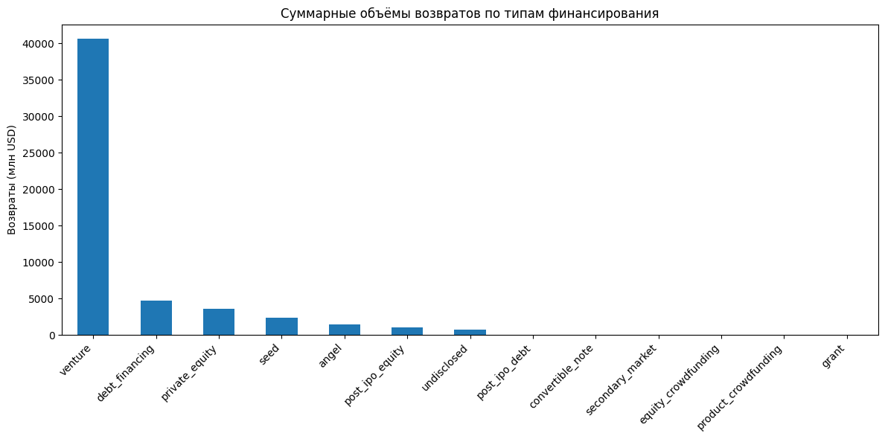

# Исследование венчурных инвестиций и стартапов

**Учебный аналитический проект** · Python · Pandas · NumPy · Seaborn · EDA · IQR

## Задача

Исследовать структуру инвестиций в стартапы: сегменты рынка, способы финансирования, выбросы и годовую динамику. Подготовить обоснованные **предварительные** выводы для инвестиционной команды с учётом качества и полноты исходных данных.

Проект выполнен на датасетах, использовавшихся в учебной программе Яндекс Практикума.

## Что сделано

- Приведены типы данных и даты, очищены числовые поля с суммами финансирования.
- Обработаны пропуски и дубликаты, рассчитаны производные признаки по периодам привлечения средств.
- Сегменты рынка разделены на массовые, средние и нишевые; проанализированы частота и объёмы финансирования.
- Выявлены аномальные объёмы финансирования **методом IQR отдельно по сегментам**.
- Исследована динамика размеров раундов, общего количества раундов и различных типов финансирования.
- Проверены ограничения полноты данных, в том числе покрытие **2014 года**.

## Результаты подготовки данных

| Показатель | Значение |
|---|---:|
| Исходных записей о компаниях | **54 294** |
| После удаления дублей и записей без необходимых сведений | **40 907** |
| Исключено на этапе первичной очистки | **24,66%** |
| После удаления выбросов IQR | **35 663** |



**Вывод:** распределение финансирования неравномерно между компаниями и сегментами, а отдельные крупные сделки существенно влияют на суммы. Поэтому в анализе типичного размера финансирования используются устойчивые оценки и сегментный подход.

**Оговорка по интерпретации:** покрытие конца 2014 года, вероятно, неполное. Кроме того, единицы измерения значений в `cb_returns.csv` не подтверждены постановкой задачи: показатели нормированных возвратов в ноутбуке являются **иллюстративными**, а не проверенным ROI. Итоговые инвестиционные рекомендации предварительные.

## Как запустить

Требуется Python 3.11 или 3.12 (локальный запуск на macOS не проверялся).

```bash
python3 -m venv .venv
source .venv/bin/activate
pip install -r requirements.txt
jupyter lab
```

Положите в папку `data/` два исходных файла:

```text
data/
├── cb_investments.zip    # файл НЕ нужно распаковывать
└── cb_returns.csv
```

Откройте [`startup_investment_analysis.ipynb`](startup_investment_analysis.ipynb) и запустите **Run All**. Ноутбук считывает архив `cb_investments.zip` напрямую через `pandas.read_csv`.

## Структура

```text
startup-investment-analysis/
├── README.md
├── startup_investment_analysis.ipynb
├── requirements.txt
├── assets/startup_trends.png
└── data/                 # файлы данных остаются локально
```

## Ограничения

- Проект учебный; инвестиционные выводы не заменяют финансовый due diligence.
- Неполнота периода и неопределённость единиц измерения не позволяют надёжно интерпретировать показатели возвратов как фактическую инвестиционную доходность.
- Исходные данные не включены в публичный репозиторий до проверки условий распространения.
